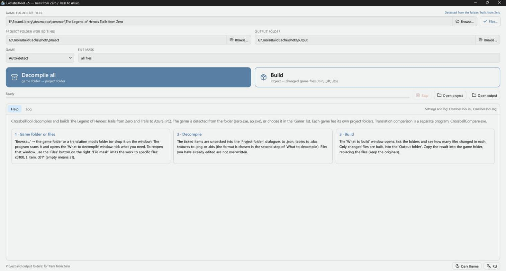
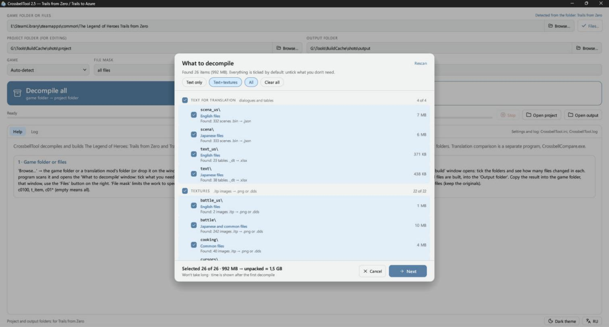
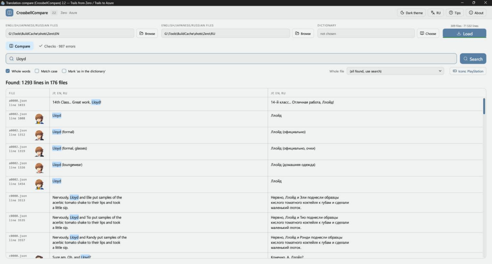
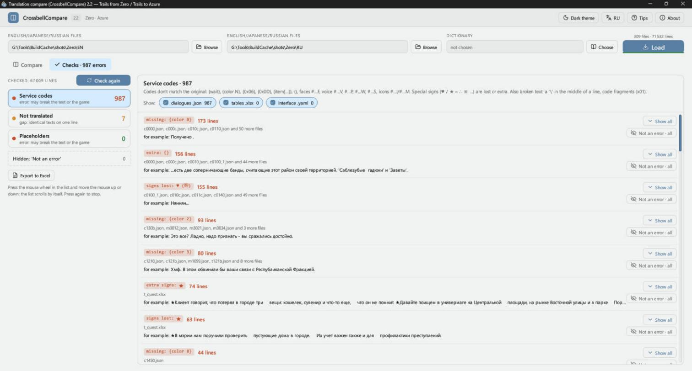

# CrossbellTool

**English** · [Русский](README_RU.md)

Building, extraction and proofreading of texts for The Legend of Heroes games (PC, Steam): Trails from Zero and Trails to Azure.

| Program | What it does |
|---|---|
| **CrossbellTool** (`CrossbellTool.exe`) | Unpacks the files from the game's `data` folder into editable files and builds your edits back into game files with the same folder structure. |
| **CrossbellCompare** (`CrossbellCompare.exe`) | Shows the text of two languages side by side, with search, a dictionary, character portraits and automatic translation checks. It only reads translation files and never writes to them. |

The interface is in English and Russian. It starts in English; the **RU / EN** button at the bottom of CrossbellTool and at the top of CrossbellCompare switches the language, and the choice is remembered. CrossbellCompare's checks and dictionary are built around a Russian translation: they treat Cyrillic text as translated and compare English against Russian.

Both programs need Windows and a graphics card with OpenGL 2 or later.

## Contents

- [Screenshots](#screenshots)
- [Quick start](#quick-start)
- [CrossbellTool](#crossbelltool-1)
- [CrossbellCompare](#crossbellcompare)
- [Command line](#command-line)
- [Building from source](#building-from-source)
- [Credits](#credits)

## Screenshots

CrossbellTool:





CrossbellCompare:





## Quick start

1. Download the archives from [Releases](../../releases) and unpack them anywhere. `data.dat` must stay next to `CrossbellCompare.exe`: it holds the game icons and portraits shown in the text.
2. In CrossbellTool, choose the game folder or a translation mod's folder under **Game folder or files**, or drop the folder on the window. Its `data` folder is used.
3. In the **What to decompile** window, tick what you need.
4. Set the **Project folder (for editing)** and the **Output folder**.
5. Click **Decompile all** and edit the files in the project folder.
6. Click **Build** and tick the folders in the **What to build** window.
7. Copy the result into the game's `data` folder, replacing the files.

Keep a copy of the originals.

Full guides: [CrossbellTool](docs/ReadMe_CrossbellTool.txt), [CrossbellCompare](docs/ReadMe_CrossbellCompare.txt). In Russian: [CrossbellTool](docs/ReadMe_CrossbellTool_RU.txt), [CrossbellCompare](docs/ReadMe_CrossbellCompare_RU.txt).

## CrossbellTool

### Supported games

| Game | Detected by |
|---|---|
| Trails from Zero | `zero.exe`, or `Zero` in the folder name |
| Trails to Azure | `ao.exe`, or `Azure` in the folder name |

The game is detected automatically, or you can choose it in the **Game** list. Each game has its own project and output folders.

### What becomes what

| Content | In the game | For editing | Edit with |
|---|---|---|---|
| Dialogues and scripts | `scena_us\*.bin` | `.json` | Notepad++ or any text editor |
| Tables (items, towns, quests, books) | `text_us\*._dt` | `.xlsx` | Excel or WPS |
| Images | `.itp` | `.png`, or `.dds` without re-encoding | Any image editor; for `.dds`, one with DDS support |

Rules for editing:

- **Dialogues:** translate the strings in `"text"`. `\n` is a new line in the window, and `{wait}` waits for a key press. Keep all other codes in place.
- **Tables:** edit column B, and don't delete or reorder rows.
- **Images:** save with transparency and don't change the size.

Old-format textures with a palette (models, maps, monsters) are skipped: they contain no text.

### Decompiling

The **What to decompile** window lists the `data` folders under text for translation and textures. For each one it shows the number of scenes, tables and images, the language and the size. At the bottom you see how much the unpacked files will take and roughly how long it will take.

- **Quick choices:** **Text only**, **Text+textures**, **All**, **Clear all**.
- **File mask:** decompile only specific files, for example `c0100, t_town, c01*`.
- **Your edits are safe:** files you have already edited are not overwritten when you decompile again.
- **Disk space:** it is checked first, and the program warns you if it's short.

### Building

Only changed files of the ticked folders are built, back into `.bin`, `._dt` and `.itp`, with the same folder structure (`scena_us`, `text_us` and so on). Without edits, files build byte-for-byte identical to the originals.

Safety checks:

- Disk space is checked before building.
- Building into the game's `data` folder or the game folder asks for confirmation first.
- A file is written through a temporary one, so if writing fails, the previous file stays intact.
- After writing, each file is reread, and scenes and tables are parsed back. A file the game couldn't read shows up in the log at once.
- If a service name (a file or model name such as `chr0000_c15`) was translated in Excel by accident, it is restored from the game's original, with a warning in the log. Numbers are not touched, because they may be changed on purpose.

## CrossbellCompare

### Loading

Each of the two fields accepts:

- the game folder or its `data` folder: `.bin` and `._dt` files are read directly, with no need to decompile;
- a translation mod's folder with `data` and `data_backup`: choose it in both fields, and Russian comes from `data` and English from `data_backup`;
- CrossbellTool projects (`.json`, `.xlsx`);
- a folder with only Japanese files. If a folder has both `scena` and `scena_us`, English is used.

Click **Load**, or drop the folders on the window. The game is detected from the folder, and on the next start the program reopens where you stopped.

Table lines are matched by file structure, so the pairs stay correct even if a translated table has its lines in a different order. If the two sides come from different games, lines aren't shown and a warning appears instead.

### Search

- Lines are found if the word is in either column, and several words find lines that have all of them.
- **Whole words** and **Match case** narrow the search. The Cyrillic letters yo and ye count as one, and all kinds of dashes, quotes and ellipses count as the same.
- **Whole file** shows all lines of one file in order.
- A line with a face code (`#0105F`) shows the speaker's portrait.
- Right-click a line to copy it or open the file at that line: `.json` in Notepad++, `.xlsx` in Excel or WPS.

### Dictionary

Choose a dictionary with the **Choose** button (`.dat`, `.json` or `.txt`, for example `Bracer = translation`). It highlights terms and shows how many times the Russian variant occurs in the found lines. **Mark 'as in the dictionary'** turns a line green when the translation uses the dictionary's words.

### Checks

| Section | What it finds |
|---|---|
| **Service codes** | Codes that don't match the original (`{wait}`, `{color N}`, `{0x06}`, `{item[…]}`, `#…F`, `#…V`, `#…P`, `#…W`, `#…I`, `#…M` and others), lost or extra special signs (`♥ ♪ ★ ━ ∴ ※`), a stray `\` in the middle of a line, code fragments |
| **Not translated** | Scene lines left in English or Japanese; tables and debug scenes are not checked |
| **Placeholders** | `%d`, `%s` where the count differs from the original |

- Identical errors are grouped, with the files and an example.
- **Open in Compare** goes to the line, and **Not an error** hides a finding. Hidden findings can be restored.
- **Export to Excel** saves the findings to `.xlsx`, one sheet per section, with five lines of context before and after each one.

The meaning of each service code is described in the [full guide](docs/ReadMe_CrossbellCompare.txt).

### Icons

`#…I` and `#…M` codes and `{item[N]}` can be shown as images from the game's textures: sepith, items, quartz, gamepad buttons for PlayStation, Xbox, Switch, Steam Deck and PS5, keyboard and mouse. This affects the display only, and nothing is written to the files.

### Hotkeys

| Keys | Action |
|---|---|
| Ctrl+F | Go to the search field |
| Enter | Search |
| F5 / Shift+F5 | Reload / reload without the cache |
| Ctrl+1 / Ctrl+2 | The Compare / Checks tab |
| Ctrl+C | Copy the clicked column |
| Ctrl+wheel, Ctrl+plus/minus, Ctrl+0 | Table text size |
| F11 | Full screen |
| Esc | Close a window or menu, or leave full screen |

## Command line

```
CrossbellTool decompile --game zero|azure --data <data folder> --proj <project folder>
              [--types scena,tables,textures] [--mask ...] [--overwrite] [--dds]
CrossbellTool compile   --proj <project folder> --out <output folder>
              [--data <data folder>] [--types ...] [--mask ...] [--all] [--no-check]
CrossbellTool file [--game zero|azure] <file>
```

`--data` in `compile` compares tables with the original, and `--all` builds everything rather than only changed files. `CrossbellTool file` converts one `.bin`, `._dt` or `.itp` file and back; `.bin` needs `--game`.

## Building from source

You need Windows, [Rust](https://rustup.rs) and Visual Studio Build Tools with a Windows SDK. The toolchain version is set in `rust-toolchain.toml`.

```
cargo build --release -p crossbell-tool
```

The programs appear in `target\release`. CrossbellCompare's `data.dat` is not in the repository because it holds images taken from the games; it is included in the release archives. Without it, the icons and portraits are not shown.

## Credits

This project includes modified copies of these libraries in the `libs` folder. All credit for them goes to their authors:

- **Kyuuhachi**, [Aureole Suite](https://aureole.kyuuhachi.dev): `calmare`, `themelios` and its `themelios-*` crates, `cradle`, `gospel`, `gospel-dump`, `cp932`, `bc7`, `bzip`.
- **Kyuuhachi**, Ingert: `ingert`, `ingert-syntax`.
- [KuroTools](https://github.com/nnguyen259/KuroTools) (MIT): table schemas.
- [Lucide](https://lucide.dev): interface icons, see [the license](tool/src/icons/LICENSE).

The Legend of Heroes and all game assets belong to Nihon Falcom. This is an unofficial fan project, and you need your own copy of the games.
