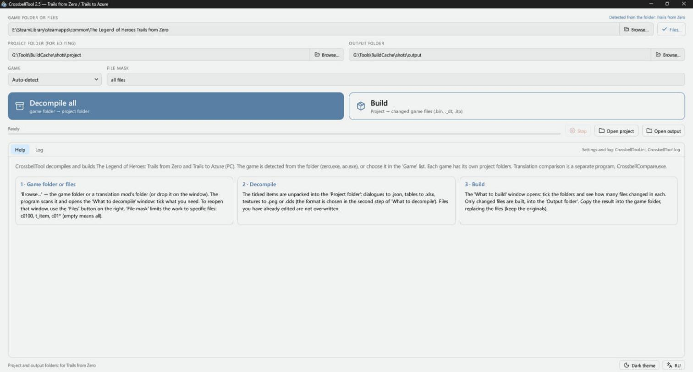
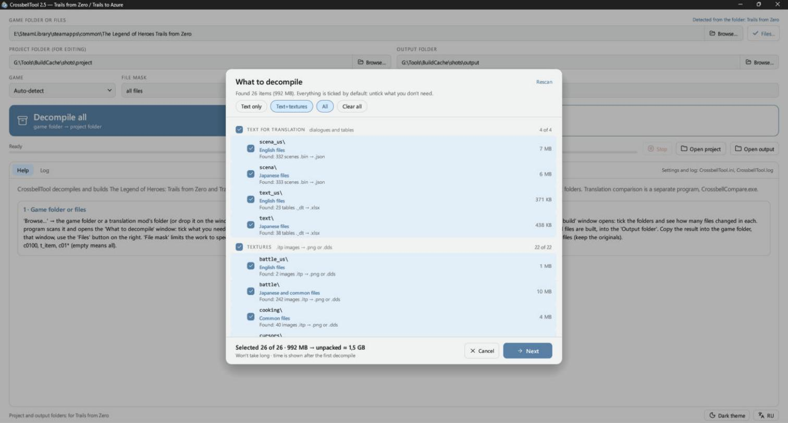
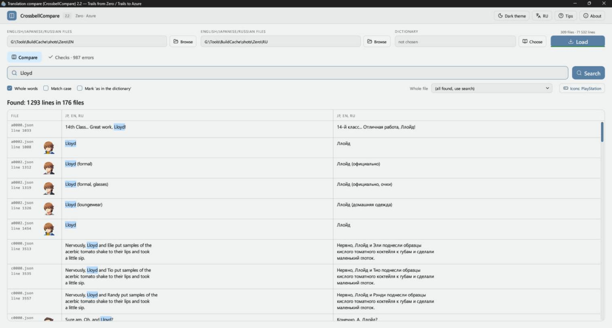
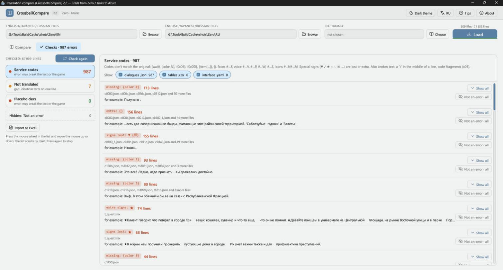

# CrossbellTool

[English](README.md) · **Русский**

Сборка, извлечение и вычитка текстов игр The Legend of Heroes (PC, Steam): Trails from Zero и Trails to Azure.

| Программа | Что делает |
|---|---|
| **CrossbellTool** (`CrossbellTool.exe`) | Разбирает файлы из папки `data` игры на файлы для правки и собирает правки обратно в файлы игры с той же структурой папок. |
| **CrossbellCompare** (`CrossbellCompare.exe`) | Показывает текст двух языков рядом, с поиском, словарём, портретами персонажей и автоматическими проверками перевода. Файлы перевода только читает и ничего в них не пишет. |

Интерфейс на английском и русском. При первом запуске он английский; кнопка **RU / EN** переключает язык и запоминает выбор. В CrossbellTool она внизу окна, в CrossbellCompare вверху. Проверки и словарь CrossbellCompare рассчитаны на русский перевод: текст на кириллице считается переведённым, а английский сравнивается с русским.

Обеим программам нужны Windows и видеокарта с OpenGL 2 и выше.

Ниже названия кнопок указаны как в русском интерфейсе.

## Содержание

- [Скриншоты](#скриншоты)
- [Быстрый старт](#быстрый-старт)
- [CrossbellTool](#crossbelltool-1)
- [CrossbellCompare](#crossbellcompare)
- [Командная строка](#командная-строка)
- [Сборка из исходников](#сборка-из-исходников)
- [Авторы](#авторы)

## Скриншоты

CrossbellTool:





CrossbellCompare:





## Быстрый старт

1. Скачайте архивы из [Releases](../../releases) и распакуйте в любую папку. `data.dat` должен лежать рядом с `CrossbellCompare.exe`: в нём значки и портреты из игр, которые показываются в тексте.
2. В CrossbellTool укажите папку игры или русификатора в поле **Папка игры или файлы** или перетащите папку на окно. Берётся её папка `data`.
3. В окне **Что разбирать** отметьте нужное.
4. Укажите **Куда сохранять для правки** и **Куда сохранять собранное**.
5. Нажмите **Декомпилировать всё** и правьте файлы в папке проекта.
6. Нажмите **Собрать** и отметьте папки в окне **Что собрать**.
7. Скопируйте результат в папку `data` игры с заменой.

Сохраните копию оригиналов.

Подробные инструкции: [CrossbellTool](docs/ReadMe_CrossbellTool_RU.txt), [CrossbellCompare](docs/ReadMe_CrossbellCompare_RU.txt).

## CrossbellTool

### Поддерживаемые игры

| Игра | Определяется по |
|---|---|
| Trails from Zero | `zero.exe` или `Zero` в имени папки |
| Trails to Azure | `ao.exe` или `Azure` в имени папки |

Игра определяется сама, или её можно выбрать в списке **Игра**. У каждой игры свои папки проекта и сборки.

### Что во что превращается

| Содержимое | В игре | Для правки | Чем править |
|---|---|---|---|
| Диалоги и скрипты | `scena_us\*.bin` | `.json` | Notepad++ или любой текстовый редактор |
| Таблицы (предметы, города, квесты, книги) | `text_us\*._dt` | `.xlsx` | Excel или WPS |
| Картинки | `.itp` | `.png` или `.dds` без перекодирования | Любой графический редактор; для `.dds` с поддержкой DDS |

Правила правки:

- **Диалоги:** переводите строки в `"text"`. `\n` означает новую строку в окне, `{wait}` ждёт нажатия. Остальные коды оставляйте на месте.
- **Таблицы:** правьте столбец B, не удаляйте и не переставляйте строки.
- **Картинки:** сохраняйте с прозрачностью, размер не меняйте.

Текстуры старого формата с палитрой (модели, карты, монстры) пропускаются: текста в них нет.

### Разборка

В окне **Что разбирать** папки `data` разделены на текст для перевода и текстуры. У каждой видно число сцен, таблиц и картинок, язык и размер. Внизу показано, сколько займут разобранные файлы и примерно сколько времени это займёт.

- **Быстрый выбор:** **Только текст**, **Текст+текстуры**, **Всё**, **Снять всё**.
- **Маска файлов:** разбирает только нужные файлы, например `c0100, t_town, c01*`.
- **Ваши правки в безопасности:** уже изменённые файлы при повторной разборке не перезаписываются.
- **Место на диске:** проверяется заранее, и если его мало, программа предупредит.

### Сборка

Собираются только изменённые файлы отмеченных папок, обратно в `.bin`, `._dt` и `.itp`, с той же структурой папок (`scena_us`, `text_us` и другие). Без правок файлы собираются байт в байт как оригинал.

Проверки при сборке:

- Перед сборкой проверяется место на диске.
- Перед сборкой в папку `data` или папку игры программа спрашивает подтверждение.
- Файл пишется через временный, поэтому при сбое прежний файл остаётся целым.
- После записи каждый файл перечитывается, а сцены и таблицы разбираются обратно. Файл, который игра не прочитала бы, сразу виден в журнале.
- Если в Excel случайно перевели служебное имя (имя файла или модели вроде `chr0000_c15`), оно возвращается как в оригинале, а в журнале появляется предупреждение. Числа не трогаются, потому что их могут менять намеренно.

## CrossbellCompare

### Загрузка

В каждом из двух полей можно указать:

- папку игры или её `data`: файлы `.bin` и `._dt` читаются напрямую, разбирать ничего не нужно;
- папку русификатора с `data` и `data_backup`: укажите её в обоих полях, русский берётся из `data`, английский из `data_backup`;
- проекты CrossbellTool (`.json`, `.xlsx`);
- папку только с японскими файлами. Если в папке есть и `scena`, и `scena_us`, берётся английский.

Нажмите **Загрузить** или перетащите папки на окно. Игра определяется по папке, а при следующем запуске программа откроется там, где вы остановились.

Строки таблиц сопоставляются по структуре файла, поэтому пары верные, даже если в переведённой таблице строки лежат в другом порядке. Если файлы с двух сторон из разных игр, вместо строк появится предупреждение.

### Поиск

- Находятся строки, где слово есть хотя бы в одном столбце. Если слов несколько, находятся строки, где есть все.
- **Целые слова** и **Учитывать регистр** сужают поиск. Буквы ё и е считаются одной, а тире любого вида, кавычки и многоточие одинаковыми.
- **Файл целиком** показывает все строки одного файла по порядку.
- У реплики с кодом лица (`#0105F`) показывается портрет говорящего.
- Правый клик по строке копирует её или открывает файл на этой строке: `.json` в Notepad++, `.xlsx` в Excel или WPS.

### Словарь

Словарь выбирается кнопкой **Выбрать** (`.dat`, `.json` или `.txt`, например `Bracer = брейсер`). Он подсвечивает термины и показывает, сколько раз русский вариант встречается в найденных строках. **Отмечать «как в словаре»** делает строку зелёной, если в переводе стоят слова из словаря.

### Проверки

| Раздел | Что находит |
|---|---|
| **Служебные коды** | Коды, не совпадающие с оригиналом (`{wait}`, `{color N}`, `{0x06}`, `{item[…]}`, `#…F`, `#…V`, `#…P`, `#…W`, `#…I`, `#…M` и другие), потерянные или лишние особые знаки (`♥ ♪ ★ ━ ∴ ※`), `\` посреди строки, обрывки кодов |
| **Не переведено** | Реплики сцен на английском или японском; таблицы и отладочные сцены не проверяются |
| **Подстановки** | `%d`, `%s`, если их не столько же, сколько в оригинале |

- Одинаковые ошибки собраны в группы, с файлами и примером.
- **Открыть в сверке** переходит к строке, а **Не ошибка** скрывает находку. Скрытые находки можно вернуть.
- **Выгрузить в Excel** сохраняет находки в `.xlsx`, по листу на раздел, с пятью репликами до и после каждой.

Что означает каждый служебный код, описано в [подробной инструкции](docs/ReadMe_CrossbellCompare_RU.txt).

### Значки

Коды `#…I`, `#…M` и `{item[N]}` могут показываться картинками из текстур игры: сепит, предметы, кварц, кнопки геймпадов PlayStation, Xbox, Switch, Steam Deck и PS5, клавиатура и мышь. Это влияет только на показ, в файлы ничего не пишется.

### Горячие клавиши

| Клавиши | Действие |
|---|---|
| Ctrl+F | Перейти в поле поиска |
| Enter | Найти |
| F5 / Shift+F5 | Загрузить заново / загрузить заново без кэша |
| Ctrl+1 / Ctrl+2 | Вкладка «Сверка» / «Проверки» |
| Ctrl+C | Скопировать столбец, по которому щёлкнули |
| Ctrl+колёсико, Ctrl+плюс/минус, Ctrl+0 | Размер текста таблицы |
| F11 | Во весь экран |
| Esc | Закрыть окно или меню, выйти из полноэкранного режима |

## Командная строка

```
CrossbellTool decompile --game zero|azure --data <папка data> --proj <папка проекта>
              [--types scena,tables,textures] [--mask ...] [--overwrite] [--dds]
CrossbellTool compile   --proj <папка проекта> --out <папка результата>
              [--data <папка data>] [--types ...] [--mask ...] [--all] [--no-check]
CrossbellTool file [--game zero|azure] <файл>
```

`--data` в `compile` сверяет таблицы с оригиналом, а `--all` собирает всё, а не только изменённое. `CrossbellTool file` переводит один файл `.bin`, `._dt` или `.itp` и обратно; для `.bin` нужен `--game`.

## Сборка из исходников

Нужны Windows, [Rust](https://rustup.rs) и Visual Studio Build Tools с Windows SDK. Версия компилятора указана в `rust-toolchain.toml`.

```
cargo build --release -p crossbell-tool
```

Программы появятся в `target\release`. `data.dat` для CrossbellCompare в репозитории нет, потому что в нём картинки из игр; он лежит в архивах релиза. Без него значки и портреты не показываются.

## Авторы

В папке `libs` лежат изменённые копии этих библиотек. Вся заслуга за них принадлежит их авторам:

- **Kyuuhachi**, [Aureole Suite](https://aureole.kyuuhachi.dev): `calmare`, `themelios` и его крейты `themelios-*`, `cradle`, `gospel`, `gospel-dump`, `cp932`, `bc7`, `bzip`.
- **Kyuuhachi**, Ingert: `ingert`, `ingert-syntax`.
- [KuroTools](https://github.com/nnguyen259/KuroTools) (MIT): схемы таблиц.
- [Lucide](https://lucide.dev): значки интерфейса, см. [лицензию](tool/src/icons/LICENSE).

The Legend of Heroes и все материалы игр принадлежат Nihon Falcom. Это неофициальный фанатский проект, для работы нужны ваши собственные копии игр.
